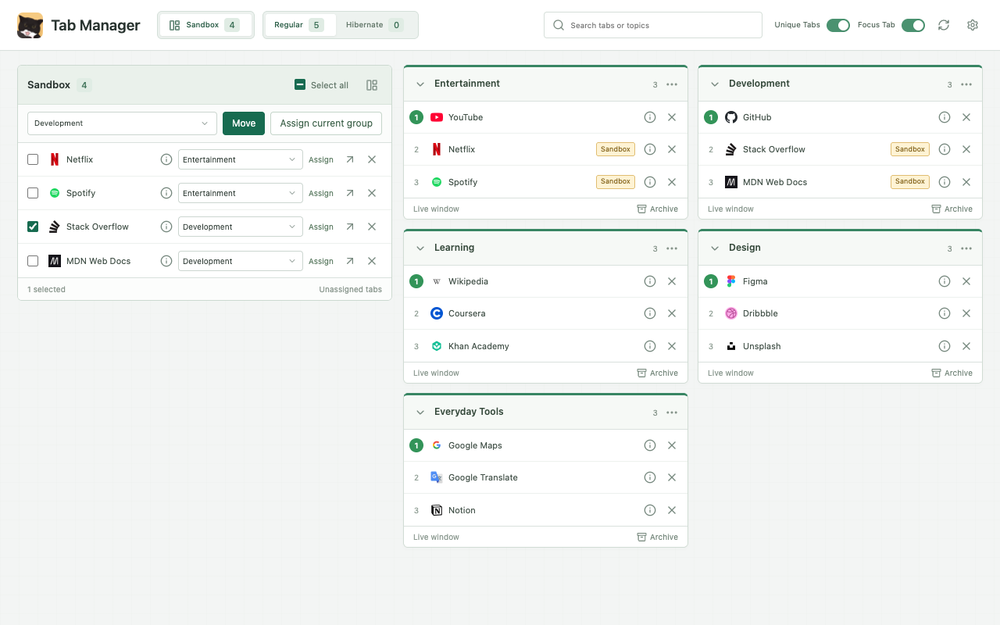
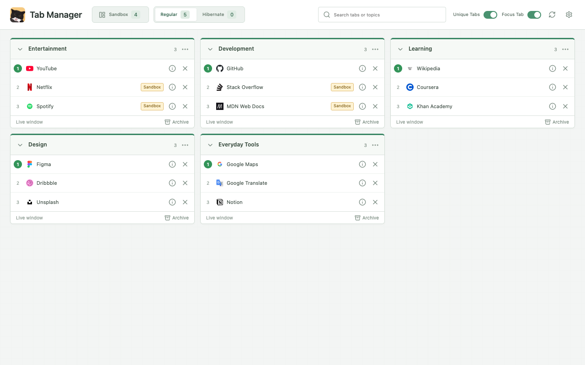

# Tab Manager

Organize tabs by topic. Keep your browser workspace under control.

Too many tabs? Tab widths shrunk to the point where you can't find anything? Different topics all jumbled together?

Tab Manager puts an end to that. It helps you organize tabs into topic-based groups, archive and restore them whenever you need, prevents duplicate tabs from opening, and uses a sandbox to better manage newly opened pages.

Your data stays local.

> A local-first Browser Manifest V3 extension for managing tabs as topics. No server,
local port, account or cloud service is required.


## Screenshots

**Sandbox open**



**Sandbox hidden**



## Install

The ready-to-load extension is in `dist/`.

1. Open `chrome://extensions` and enable Developer mode.
2. Choose **Load unpacked** and select this project's `dist` directory.
3. Pin **Tab Manager** and click its icon to open the manager directly. If a manager
	tab already exists, it is activated instead of opening another copy.

After changing source files, run `npm run build` and reload the extension. Do not
load the project root: the compiled service worker and pages live in `dist`.

## Features

- One real Chrome window per live topic; names, main topic, order and Hibernate.
- Extension icon badge shows the current window topic's first four characters;
	hover displays its full name. Renames and window switches update automatically.
	Unnamed and incognito windows clear the badge. Badge updates never activate tabs
	or focus browser windows.
- Adjustable Sandbox with selection, current-topic assignment, target assignment,
	live/archive targets, focus and immediate close. Hide it without a placeholder.
- Drag tabs between live windows and archives; drag topic headers to reorder.
- Native tab ordering, individual names, favicon, details and exact duplicate colors.
- Batch filtering, select/move/delete, website sorting and duplicate removal.
- Persisted archive/restore, including automatic archival of manually closed windows.
- Exact-URL reuse (enabled by default): prefer a live tab, otherwise restore the matching archived
	topic and activate its target. Multiple archived matches open a chooser.
- Reuse pause, next-tab bypass and website exceptions. Managed restoration is exempt;
	ordinary navigation in existing tabs is not intercepted. Incognito is excluded.
- Validated JSON backup export/import. Imports add archives; they do not replace data.

## Data and Safety

IndexedDB stores topics, names, settings and pending reuse decisions inside the
extension's browser profile. Nothing is sent to a server. The `tabs`, `storage`
and `alarms` permissions are sufficient; no cookies or broad host permissions
are requested. Websites themselves still make their normal network requests.

Group/tab identities are independent of Chrome IDs. After a browser restart,
windows with the exact saved URL sequence or a unique high-overlap URL set recover
their names/metadata. High-overlap matching requires at least two shared exact URLs,
80% overlap and a clear margin over alternatives. Missing cached tabs remain in
backup exports; unmatched windows become archives. Chrome ID mappings are
scoped to a browser session. The extension's own pages are not managed as tabs.

Archival is saved before closure. Failed restoration preserves the archive and
closes its partially created window when possible. A 15-second startup grace
period protects browser session recovery. New-tab reuse watches HTTP/HTTPS tabs
for up to one minute and waits for completed navigation. URL equality is literal
on the strings Chrome exposes: no case folding, query sorting or fragment removal.
Chrome itself may canonicalize URLs before exposing them.

**Reuse exact URLs** is enabled for new or unset settings. Previously saved choices
are preserved; toggle it in manager settings at any time. A blank/new-tab page or pending navigation does not consume the
one-minute detection window. Once the final HTTP/HTTPS URL finishes loading, it is
compared in full; sharing only a domain does not make two tabs duplicates. Pause,
website exceptions and the next-tab bypass still apply.

Export backups regularly. Removing the extension or clearing its browser data can
delete local archives. Backup files contain private URLs: store them accordingly.

## Development

Live topics are displayed before archives. Navigation, search, refresh and global
actions share the main header. Archived topics use neutral gray backgrounds and
grayscale favicons. Restored tabs have explicit per-tab reuse exemptions, and each
new-tab reuse decision is consumed only once. A restore creates its window in the
background and focuses the selected target once after creation is complete.

Settings include Sandbox width, minimum topic card width and visible tabs per topic.
Cards expand to fill their row; longer topics scroll within the configured tab limit.
Sandbox tabs and the bulk toolbar stay on a single line; its minimum width is 470px.
Narrow windows scroll the workspace horizontally rather than wrapping its controls.
The default 480px Sandbox and 320px minimum topic width display two topic columns
with Sandbox open and three with it closed at a 1280px viewport. Set minimum topic
width to 280px for four columns with Sandbox closed. Layout preferences stay local.

```sh
npm install
npm run dev
npm run test
npm run build
npx playwright install chromium
npm run test:e2e
```

The ordinary browser dev page is a clearly marked Preview using a separate local
database and simulated browser operations. It never controls your real tabs. Preview
URLs are sample data only. The loaded extension always uses the real Chrome adapter.

`test:e2e` loads `dist` in a fresh isolated Chromium profile, exercises native
archive/restore, exact reuse, automatic topic restore, multiple-archive selection,
backup import and desktop/mobile UI, and removes the test profile afterward.
Screenshots are written under `.test-runtime/`.

## Architecture

- `src/core/model.js`: safe data models, exact matching and backup validation.
- `src/core/database.js`: IndexedDB persistence using `idb`.
- `src/core/engine.js`: serialized local topic/tab operations and reuse decisions.
- `src/core/chrome-browser.js`: thin Chrome API adapter with restore rollback.
- `src/background/index.js`: MV3 events, periodic reconciliation and message RPC.
- `src/client.js`: extension messaging or isolated preview adapter.
- `src/App.vue`: full manager; `src/pages/`: compiled archive chooser.
- `src/background/open-manager.js`: direct toolbar action with existing-tab reuse.
- `public/manifest.json`: minimal extension permissions; all code/fonts/icons bundled.

Icons are bundled under `public/icons` and validated during builds. Fonts and
scripts are packaged locally; no external resources are needed for the interface.
